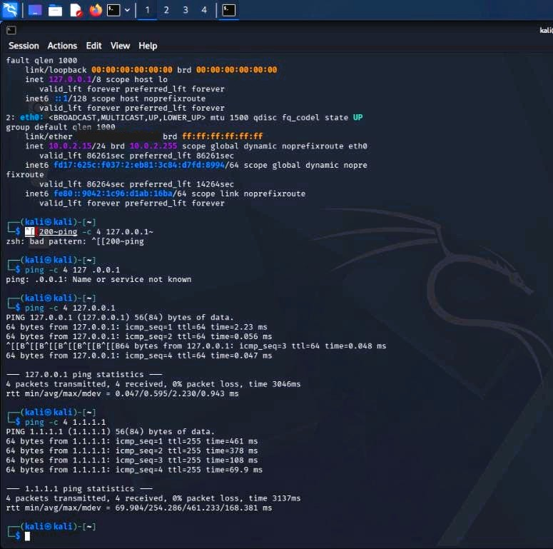
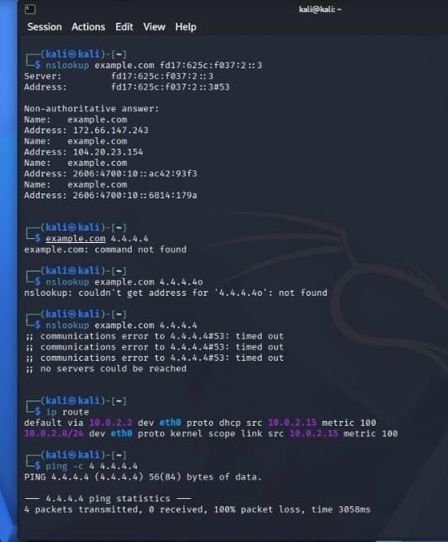
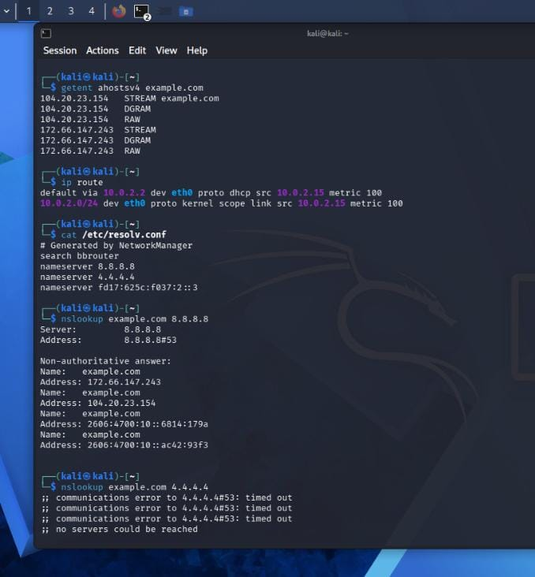
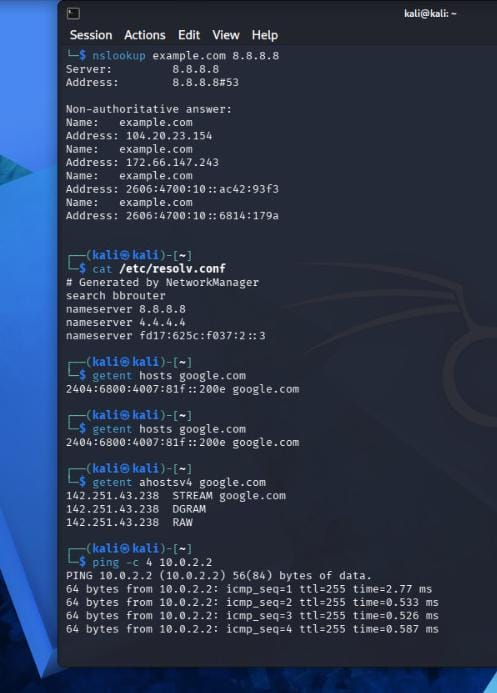

# IT Support & Network Troubleshooting Lab

## About This Project

A hands-on learning project focused on IT support fundamentals,
Linux networking, DNS diagnostics, Windows network troubleshooting,
and technical documentation.

This project demonstrates practical troubleshooting exercises
performed using command-line tools in Kali Linux and Windows.

## Environment

- Kali Linux
- Windows 11
- Oracle VirtualBox
- Linux and Windows command-line tools

## Case Studies

### Case Study 01: Network Connectivity and DNS Diagnostics

Practised checking network connectivity, examining routing
information, and testing DNS resolution using IPv4 and IPv6.

**Tools used:** `ping`, `ip addr`, `ip route`, `getent`, `nslookup`

**Report:** [Read Case Study 01](case-01-network-dns-diagnostics.md)

### Case Study 02: DNS Server Troubleshooting

Compared DNS server responses to investigate successful DNS
resolution and timeouts. Documented the findings without
assuming an unconfirmed root cause.

**Report:** [Read Case Study 02](case-02-dns-server-troubleshooting.md)

### Case Study 03: Windows Network Diagnostics

Used Windows Command Prompt to examine IP configuration,
test router connectivity, verify external connectivity,
and check DNS resolution.

**Tools used:** `ipconfig`, `ping`, `nslookup`

**Report:** [Read Case Study 03](case-03-windows-network-diagnostics.md)

## Evidence and Screenshots

Screenshots documenting the troubleshooting exercises are
available in the [Screenshots folder](Screenshots/).

### Network Connectivity Tests

### DNS Server Troubleshooting

### DNS Server Comparison

### DNS Configuration and Gateway

## Case Study Reports

- [Case Study 01: Network Connectivity and DNS Diagnostics](case-01-network-dns-diagnostics.md)
- [Case Study 02: DNS Server Troubleshooting](case-02-dns-server-troubleshooting.md)
- [Case Study 03: Windows Network Diagnostics](case-03-windows-network-diagnostics.md)

## Skills Practised

- Linux command-line fundamentals
- Windows command-line fundamentals
- Network connectivity testing
- IP addressing and routing
- DNS troubleshooting
- IPv4 and IPv6 fundamentals
- Technical documentation
- Troubleshooting and result analysis

## Project Status

Completed three introductory troubleshooting case studies.
Further practical exercises may be added as skills develop.

## Disclaimer

This repository contains educational lab exercises.
Findings are based on the tests performed, and unconfirmed
causes are not presented as established facts.
