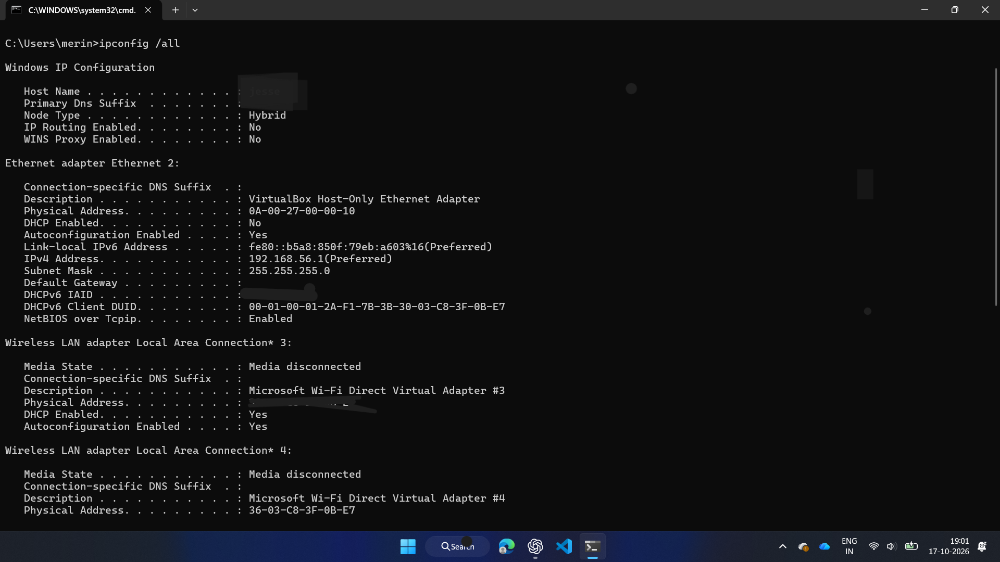
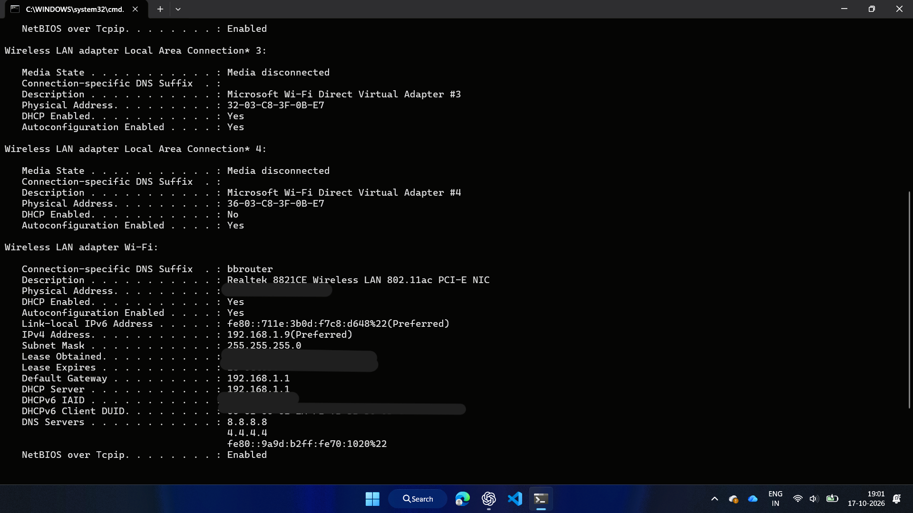

# Case Study 03: Windows Network Diagnostics

## Objective
To practise basic network troubleshooting on a Windows 11 laptop
using Command Prompt.

## Environment
- Operating System: Windows 11
- Network: Wi-Fi
- IPv4 Address: 192.168.1.9
- Default Gateway: 192.168.1.1

## Tests Performed

### 1. IP Configuration
Command:
ipconfig

Result:
Identified the laptop's IPv4 address, subnet mask, and default gateway.

### 2. Router Connectivity
Command:
ping -n 4 192.168.1.1

Result:
- Packets sent: 4
- Packets received: 4
- Packet loss: 0%

Conclusion:
The laptop successfully communicated with its default gateway.

### 3. External IP Connectivity
Command:
ping -n 4 1.1.1.1

Result:
- Packets sent: 4
- Packets received: 4
- Packet loss: 0%
- Average response time: 45 ms

Conclusion:
The laptop successfully reached the external IP address.

### 4. DNS Resolution
Command:
nslookup example.com

Result:
The DNS query succeeded using the DNS server reported as
dns.google at 8.8.8.8.

Conclusion:
The hostname example.com was successfully resolved to IP addresses.

### 5. Domain Connectivity
Command:
ping -n 4 example.com

Result:
- Packets sent: 4
- Packets received: 4
- Packet loss: 0%
- Minimum response time: 44 ms
- Maximum response time: 161 ms
- Average response time: 73 ms

Conclusion:
The domain resolved to an IPv4 address and responded to ping requests.

### 6. DNS Configuration Review
Command:
ipconfig /all

Result:
The Wi-Fi adapter listed these DNS server addresses:
- 8.8.8.8
- 4.4.4.4
- fe80::9a9d:b2ff:fe70:1020%22

Conclusion:
Multiple DNS server addresses were configured. This check alone
does not establish whether every listed server is reachable or reliable.

## Final Findings
The router connectivity, external IP connectivity, DNS lookup,
and domain ping tests succeeded.

No network fault was identified during these tests.
No configuration changes were made.
## 7 Screenshots and Evidence

### 1. Windows IP Configuration

### 2. Connectivity and DNS Tests

## 8. Troubleshooting Analysis

The network troubleshooting tests produced successful results for the tested gateway, external IP address, and domain name.

The default gateway at `192.168.1.1` responded successfully, and the external IP address `1.1.1.1` was reachable during testing.

The `nslookup` command successfully resolved `example.com` using the configured DNS server `8.8.8.8`.

The domain connectivity test also completed successfully, with all four ping requests receiving replies.

The `ipconfig /all` command displayed the configured DNS server addresses. However, the presence of multiple DNS server entries does not confirm that every server is reachable or responding correctly.

No network fault was identified during these tests, and no configuration changes were made.

## 9. Conclusion

The exercise demonstrated how to troubleshoot basic network connectivity and DNS resolution in Windows 11 using command-line tools.

The gateway connectivity, external IP connectivity, DNS resolution, and domain connectivity tests were successful.

The results indicate that the tested network functions were working during the troubleshooting session. No specific network problem was identified, and no permanent fix was required.

## 10. Lessons Learned

- `ipconfig` helps identify the IP address, subnet mask, and default gateway.
- `ipconfig /all` provides detailed network configuration information.
- `ping` helps test connectivity to a gateway, external IP address, or domain.
- `nslookup` helps verify DNS resolution for a domain name.
- Testing an IP address separately from a domain name helps distinguish basic IP connectivity checks from DNS-dependent checks.
- Configured DNS server addresses do not guarantee that every server is reachable.
- Troubleshooting reports should record actual results without claiming problems or fixes that were not confirmed.

## 11. Skills Practised

- Windows network configuration inspection
- IPv4 addressing and default gateway identification
- Network connectivity testing
- DNS resolution troubleshooting
- Using Windows Command Prompt
- Analysing command-line output
- Identifying network configuration details
- Technical documentation and reporting

## 12. Disclaimer

This report documents educational network troubleshooting exercises performed in a personal lab environment. The findings reflect the results recorded during testing. No network fault was identified, and no configuration changes were made.
